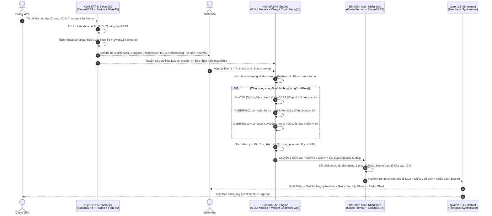
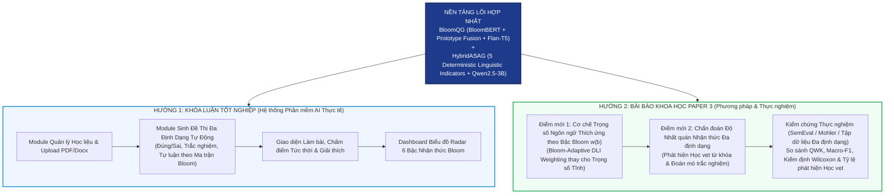

# Kiến trúc Hệ thống: Closed-Loop BloomQG + HybridASAG

Tài liệu này mô tả chi tiết **Kiến trúc Hệ thống (System Architecture)** của đề xuất hợp nhất giữa hệ thống **Tạo câu hỏi đa định dạng theo thang đo Bloom (`BloomQG`)** và hệ thống **Chấm điểm câu trả lời ngắn đa tiêu chí có giải thích (`HybridASAG`)**.

---

## 1. Sơ đồ Tổng quan Kiến trúc Hệ thống (End-to-End System Architecture)

```mermaid
flowchart LR
    subgraph L1["1. Đầu vào & Trích xuất Khái niệm"]
        Doc["Tài liệu Học tập<br/>(PDF / Slide / Văn bản)"]
        KB["KeyBERT Extractor<br/>(all-MiniLM-L6-v2)"]
        BM["Ma trận Nhận thức Bloom<br/>Chọn bậc b ∈ {1..6}"]
        Seed["Bộ Hạt giống Sinh đề<br/>(Context C, Keyphrase A, Bloom b)"]
        Doc --> KB --> BM --> Seed
    end

    subgraph L2["2. Tạo câu hỏi Đa định dạng (BloomQG Engine)"]
        BE["BloomEncoder (BloomBERT)<br/>Mã hóa Nhận thức (Acc: 90.12%)"]
        FL["Prototype-Guided FusionLayer<br/>(6 Vector Nguyên mẫu Bloom)"]
        FG["Flan-T5 + Qwen2.5 Formatter<br/>Sinh Câu hỏi Q + Đáp án chuẩn R"]
        TF["Đúng / Sai<br/>[Bậc Remember]<br/>Đảo mệnh đề"]
        MCQ["Trắc nghiệm MCQ<br/>[Bậc Understand]<br/>+3 Phương án nhiễu"]
        SA["Tự luận Ngắn<br/>[Bậc Analyze/Evaluate]<br/>Câu hỏi mở Q"]
        Stu["Phiên Làm bài của Sinh viên<br/>(S_TF, S_MCQ, S_ShortAnswer)"]

        BE --> FL --> FG
        FG --> TF & MCQ & SA
        TF & MCQ & SA --> Stu
    end

    subgraph L3["3. Chấm điểm Thích ứng 5 Tiêu chí (HybridASAG)"]
        WC["Bộ Điều khiển Trọng số Thích ứng w(b)<br/>• Remember/Understand: Ưu tiên w_cov, w_sem<br/>• Analyze/Evaluate: Ưu tiên w_log (NLI = 0.45)"]
        subgraph DLI["5 Mô hình Ngôn ngữ Tất định Song song (~62ms)"]
            M1["SimCSE<br/>Ngữ nghĩa (s_sem)"]
            M2["KeyBERT<br/>Độ phủ từ khóa (s_cov)"]
            M3["RoBERTa-CoLA<br/>Ngữ pháp (s_gra)"]
            M4["RoBERTa-Formality<br/>Văn phong (s_for)"]
            M5["DeBERTa-v3 NLI<br/>Logic & Mâu thuẫn (s_log)"]
        end
        AGG["Tổng hợp Điểm Minh bạch & Phạt Mâu thuẫn<br/>y = 10 × Σ w_i(b) · s_i   (Cap ≤ 4.0 nếu P_c > 0.90)"]
        DIAG["Chẩn đoán Nhận thức Đa định dạng<br/>Đối chiếu (T/F + MCQ + Tự luận + BloomBERT)<br/>Phát hiện Học vẹt vs. Hiểu sâu"]

        WC --> AGG
        M1 & M2 & M3 & M4 & M5 --> AGG
        AGG --> DIAG
    end

    subgraph L4["4. Tổng hợp Phản hồi & Hồ sơ Nhận thức"]
        QW["Qwen2.5-3B-Instruct (4-bit NF4)<br/>Tổng hợp Phản hồi từ Bằng chứng<br/>(Khóa điểm số - Hallucination 1.24%)"]
        OUT1["1. Điểm số & Nhãn lỗi<br/>(VD: 1.0/3.0 | Logical Error)"]
        OUT2["2. Giải thích Chi tiết (Explanatory)<br/>Chỉ rõ thiếu quan hệ nhân quả X → Y"]
        OUT3["3. Gợi ý Cải thiện theo Bậc Bloom<br/>Hướng dẫn nâng từ Understand → Analyze"]
        OUT4["4. Biểu đồ Radar 6 Bậc Bloom<br/>Hồ sơ năng lực cá nhân hóa"]

        QW --> OUT1 & OUT2 & OUT3 & OUT4
    end

    Seed -->|"(C, Keyphrase A, b)"| BE
    FL -.->|"Truyền bậc nhận thức b"| WC
    Stu -->|"(Q, R, S_ShortAnswer)"| DLI
    Stu -->|"Điểm (S_TF, S_MCQ)"| DIAG
    DIAG -->|"5 DLIs + Điểm y + Chẩn đoán"| QW

    style L1 fill:#eff6ff,stroke:#3b82f6,stroke-width:2px
    style L2 fill:#f0fdf4,stroke:#16a34a,stroke-width:2px
    style L3 fill:#faf5ff,stroke:#9333ea,stroke-width:2px
    style L4 fill:#fff7ed,stroke:#ea580c,stroke-width:2px
    style WC fill:#ffedd5,stroke:#ea580c,stroke-width:2px
    style M5 fill:#fee2e2,stroke:#dc2626,stroke-width:2px
    style DIAG fill:#fce7f3,stroke:#db2777,stroke-width:2px
```

---

## 2. Sơ đồ Tuần tự Luồng Xử lý Khép kín (Sequence Diagram)

---

## 3. Sơ đồ Phân tách Hai Hướng Khai thác: Khóa luận Tốt nghiệp vs. Paper 3

---

## 4. Danh mục các File Kiến trúc trong Thư mục `docs/`

| File | Định dạng | Mục đích sử dụng |
| :--- | :--- | :--- |
| [`bloom_hybrid_architecture.png`](file:///d:/Github/AutoGradeSystem/docs/bloom_hybrid_architecture.png) | Hình ảnh PNG (250 DPI) | Chèn trực tiếp vào Slide thuyết trình, file Word báo cáo và bài báo. |
| [`bloom_hybrid_architecture.drawio`](file:///d:/Github/AutoGradeSystem/docs/bloom_hybrid_architecture.drawio) | Draw.io XML | Mở bằng ứng dụng **draw.io / diagrams.net** để chỉnh sửa trực quan từng khối. |
| [`bloom_hybrid_architecture.excalidraw`](file:///d:/Github/AutoGradeSystem/docs/bloom_hybrid_architecture.excalidraw) | Excalidraw JSON | Mở bằng **Excalidraw** (trên Web hoặc VS Code extension) để trình bày dạng bảng trắng kỹ thuật. |
| [`BLOOM_HYBRID_ARCHITECTURE.md`](file:///d:/Github/AutoGradeSystem/docs/BLOOM_HYBRID_ARCHITECTURE.md) | Markdown + Mermaid | Xem trực tiếp sơ đồ luồng và sơ đồ tuần tự trên GitHub / VS Code. |
