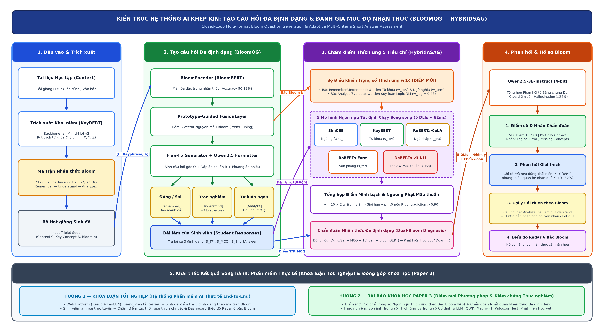

# Đề xuất Cải tiến: Hệ thống AI Khép kín Tạo câu hỏi Đa định dạng và Đánh giá Mức độ Nhận thức theo Thang đo Bloom

## 1. Bài tham khảo

* **Bài 1 — Framework AERA: Chấm điểm + Giải thích sửa lỗi tự động bằng Open-Source LLM:**
  * **Trích dẫn:** Song et al. (2024). *Automated Essay Scoring and Revising Based on Open-Source Large Language Models*. IEEE Transactions on Learning Technologies, Vol. 17, pp. 1920–1930.
  * **DOI:** https://doi.org/10.1109/TLT.2024.3396873 | **Rank:** Q1
  * **Điểm cốt lõi:** *"Song et al. (2024) chứng minh rằng các mô hình ngôn ngữ lớn mã nguồn mở (Open-source LLMs) có thể thực hiện đồng thời việc chấm điểm và sinh phản hồi sửa chữa có chất lượng tương đương con người, giải quyết hạn chế về chi phí và tính đóng của các hệ thống thương mại trước đó."*

* **Bài 2 — Hệ thống chấm + phản hồi giải thích có căn cứ từ tài liệu (Modular RAG):**
  * **Trích dẫn:** Stahl et al. (2024). *Beyond Scores: A Modular RAG-Based System for Automatic Short Answer Scoring with Feedback*. arXiv:2409.20042 / IEEE.
  * **Link:** https://ieeexplore.ieee.org/document/10771759 | **Rank:** Q2
  * **Điểm cốt lõi:** Xây dựng hệ thống chấm câu trả lời ngắn dạng module kết hợp truy xuất tài liệu học tập (RAG), vừa cho điểm vừa sinh phản hồi giải thích có căn cứ rõ ràng. Bài báo phát triển từ hướng nghiên cứu phản hồi giải thích *"Your answer is incorrect... would you like to know why?"* của Filighera et al. (2022).

* **Bài 3 — Chấm điểm câu trả lời ngắn giải thích được dựa trên bộ tiêu chí ngôn ngữ tường minh:**
  * **Trích dẫn:** Aggarwal et al. (2025). *"I understand why I got this grade": Automatic Short Answer Grading (ASAG) with Feedback*. International Conference on Artificial Intelligence in Education (AIED), Springer. *(Kết hợp Künnecke et al., 2024 — Explainable Neuro-Symbolic Pipeline for ASAG).*
  * **Điểm cốt lõi:** Chứng minh rằng việc tách biệt khâu tính điểm bằng các chỉ số ngôn ngữ tường minh khỏi khâu viết lời nhận xét của LLM giúp điểm số khách quan, minh bạch và giảm thiểu tối đa hiện tượng ảo giác (hallucination).

---

## 2. Mục tiêu chính

Đề xuất xây dựng một **Hệ thống Đánh giá Nhận thức Khép kín (Closed-Loop Cognitive Assessment System)** bằng cách hợp nhất quy trình **Tạo câu hỏi tự động (AQG)** và **Chấm điểm câu trả lời tự động (ASAG)** trên cùng một thước đo nhận thức **Bloom's Taxonomy**, với 4 khả năng chính:
1. **Tự động tạo câu hỏi đa định dạng từ tài liệu học tập:** Từ một văn bản bài giảng bất kỳ, hệ thống tự động sinh bộ câu hỏi gồm **Đúng/Sai**, **Trắc nghiệm (MCQ)** và **Tự luận ngắn**, được điều khiển chặt chẽ theo 6 bậc nhận thức của thang đo Bloom (*Remember, Understand, Apply, Analyze, Evaluate, Create*).
2. **Chấm điểm tự động và minh bạch:** Chấm điểm tức thời các câu Đúng/Sai, Trắc nghiệm và chấm điểm chi tiết câu Tự luận thông qua **5 tiêu chí ngôn ngữ độc lập** (Ngữ nghĩa, Độ phủ từ khóa, Ngữ pháp, Văn phong học thuật, và Tính nhất quán logic).
3. **Đánh giá mức độ nhận thức thực tế của sinh viên:** Không chỉ kết luận câu trả lời đúng hay sai, hệ thống còn chẩn đoán xem sinh viên đang thực sự dừng ở bậc nhận thức nào (ví dụ: phát hiện sinh viên chỉ *"nhớ máy móc / học vẹt"* hay đã *"hiểu và phân tích được bản chất"*).
4. **Sinh phản hồi giải thích (Explanatory Feedback) và gợi ý theo thang Bloom:** Giúp sinh viên hiểu rõ vì sao mình đạt mức điểm đó, thiếu ý nào, và cần bổ sung lập luận gì để nâng cấp câu trả lời lên đúng bậc nhận thức mà câu hỏi yêu cầu, đồng thời giảm tải công việc ra đề – chấm bài cho giảng viên.

---

## 3. Lý do chọn phương pháp

Các hệ thống AI trong giáo dục hiện nay thường tách rời khâu "Ra đề" và khâu "Chấm bài", dẫn đến nhiều hạn chế:
* **Hạn chế ở chiều Tạo câu hỏi:** Đa số mô hình chỉ sinh được một dạng câu hỏi đơn lẻ và không gắn kết với tiêu chí chấm điểm ở đầu ra.
* **Hạn chế ở chiều Chấm điểm truyền thống:**
  * Các hệ thống chỉ đưa ra một con số điểm cuối cùng hoặc chỉ so khớp từ vựng/ngữ nghĩa bề mặt, dễ bị đánh lừa khi sinh viên nhồi nhét từ khóa đúng nhưng giải thích sai bản chất logic.
  * Nếu giao toàn bộ việc chấm điểm cho một LLM duy nhất thì điểm số thiếu ổn định, dễ xảy ra ảo giác (chấm điểm rất cao cho các câu trả lời viết trôi chảy nhưng sai kiến thức).
* **Hạn chế đối với người học:** Học sinh không biết mình sai ở tầng kiến thức nào (thiếu khái niệm cơ bản hay thiếu lập luận nhân – quả) để tự cải thiện.

**Để khắc phục các vấn đề trên, nhóm đề xuất phương pháp kết hợp 3 trụ cột:**

1. **Tạo câu hỏi đa định dạng điều khiển theo bậc Bloom (Bloom-Guided Multi-Format Question Generation):**
   * Trích xuất các khái niệm trọng tâm từ tài liệu học tập bằng mô hình rút trích từ khóa (`KeyBERT`), sau đó kết hợp bộ mã hóa nhận thức (`BloomBERT` + tầng kết hợp vector nguyên mẫu 6 bậc Bloom + mô hình sinh ngôn ngữ `Flan-T5`/`Qwen2.5`) để tạo câu hỏi tương ứng với từng cấp độ tư duy:
     * *Câu hỏi Đúng/Sai:* Kiểm tra mức **Nhớ (Remember)** qua việc nhận diện mệnh đề đúng hoặc mệnh đề bị đảo ngược thông tin.
     * *Câu hỏi Trắc nghiệm (MCQ):* Kiểm tra mức **Hiểu & Vận dụng (Understand / Apply)** thông qua đáp án đúng và 3 phương án nhiễu hợp lý.
     * *Câu hỏi Tự luận ngắn:* Kiểm tra mức **Phân tích & Đánh giá (Analyze / Evaluate)**, đòi hỏi sinh viên phải lập luận và giải thích mối quan hệ giữa các khái niệm.

2. **Chấm điểm đa tiêu chí có Trọng số thích ứng theo bậc Bloom (Bloom-Adaptive Multi-Criteria Scoring — *Điểm mới cốt lõi*):**
   * Câu trả lời tự luận của sinh viên được đánh giá qua 5 mô hình ngôn ngữ chuyên biệt: Độ tương đồng ngữ nghĩa (`SimCSE`), Độ phủ từ khóa (`KeyBERT`), Ngữ pháp (`RoBERTa-CoLA`), Văn phong (`RoBERTa-Formality`), và Suy luận logic/Phát hiện mâu thuẫn (`DeBERTa-v3 NLI`).
   * **Cơ chế thích ứng:** Thay vì dùng một công thức tính điểm cố định cho mọi câu hỏi, **cấp độ Bloom của câu hỏi ở đầu vào sẽ tự động điều chỉnh trọng số chấm điểm ở đầu ra**:
     * Với câu hỏi mức thấp (*Remember / Understand*): Hệ thống ưu tiên trọng số **Độ phủ từ khóa** và **Độ tương đồng ngữ nghĩa** (kiểm tra xem sinh viên có nắm đúng thuật ngữ và ý chính không).
     * Với câu hỏi mức cao (*Analyze / Evaluate*): Hệ thống tự động đẩy cao trọng số **Suy luận logic (NLI)** để kiểm tra tính chặt chẽ nhân – quả và phạt nặng các câu trả lời mâu thuẫn với tài liệu gốc dù có chứa nhiều từ khóa đúng.

3. **Chẩn đoán nhận thức chéo & Sinh phản hồi giải thích bằng Open-Source LLM (`Qwen2.5-3B`):**
   * Hệ thống đối chiếu kết quả làm bài ở cả 3 định dạng (Đúng/Sai, Trắc nghiệm, Tự luận) cùng bộ phân loại nhận thức `BloomBERT` để phát hiện hiện tượng **"đoán mò trắc nghiệm"** hoặc **"học vẹt từ khóa"**.
   * Cuối cùng, mô hình ngôn ngữ mở `Qwen2.5-3B` dựa trên bảng điểm 5 tiêu chí và kết quả chẩn đoán Bloom để viết lời nhận xét chi tiết và hướng dẫn sửa bài, đảm bảo minh bạch và có căn cứ khoa học.

---

## 4. Bảng đối chiếu Phương pháp & Kết quả thực nghiệm

| Phương pháp | Chức năng chính | Kết quả & Đánh giá |
| :--- | :--- | :--- |
| **Chấm điểm truyền thống / So khớp từ vựng** | Chỉ cho điểm dựa trên độ trùng lặp từ ngữ | Không hỗ trợ học tập; dễ chấm nhầm câu trả lời học vẹt (nhiều từ khóa nhưng sai bản chất). |
| **Chấm điểm bằng Deep Learning hộp đen** | Dự đoán điểm số tự động (End-to-End) | Độ chính xác khá nhưng thiếu minh bạch, học sinh không biết vì sao bị trừ điểm. |
| **Open-Source LLM & RAG (Song et al., 2024; Stahl et al., 2024)** | Chấm điểm + sinh phản hồi dựa trên tài liệu | Chất lượng phản hồi tương đương người chấm, có căn cứ, nhưng chưa điều khiển và đo lường theo thang nhận thức Bloom. |
| **Hệ thống Tạo câu hỏi theo Bloom độc lập (Nền tảng 1 của nhóm)** | Tạo câu hỏi đơn lẻ theo 6 bậc Bloom (`BloomBERT + Flan-T5`) | Phân loại Bloom đạt ~90.12% và sinh câu hỏi đúng cấp độ, nhưng chưa có đa định dạng (MCQ, Đúng/Sai) và chưa chấm được câu trả lời. |
| **Hệ thống Chấm điểm 5 tiêu chí độc lập (Nền tảng 2 của nhóm)** | Chấm câu trả lời ngắn (5 tiêu chí tĩnh) + Giải thích bằng `Qwen2.5` | Độ tương đồng với người chấm đạt **85.50% QWK**, giảm tỷ lệ ảo giác từ 10.73% xuống **1.24%**, nhưng chưa tự tạo câu hỏi và chưa đánh giá mức độ nhận thức. |
| **Hệ thống Hợp nhất Đề xuất (Cải tiến mới)** | **Tạo câu hỏi đa định dạng + Chấm điểm thích ứng 5 tiêu chí + Chẩn đoán & Phản hồi theo Bloom** | **Khép kín toàn diện: Ra đề đa định dạng từ tài liệu $\rightarrow$ Chấm điểm minh bạch $\rightarrow$ Đo lường chính xác mức độ nhận thức của sinh viên.** |

---

## 5. Minh họa Đầu ra Mới của Hệ thống (New Output)

Giả sử giảng viên đưa vào tài liệu bài giảng quy định mối quan hệ giữa các khái niệm $X, Y, Z$. Hệ thống tự động sinh bộ câu hỏi 3 định dạng và xuất báo cáo đánh giá bài làm của sinh viên như sau:

* **Phần 1 — Bộ câu hỏi tự động sinh từ tài liệu:**
  1. *[Đúng/Sai - Bậc Remember]:* Kiểm tra định nghĩa cơ bản của khái niệm $X$ $\rightarrow$ Sinh viên chọn: **Đúng** *(Đạt 1/1)*.
  2. *[Trắc nghiệm - Bậc Understand]:* Chọn phát biểu đúng về vai trò của $Y$ trong hệ thống $\rightarrow$ Sinh viên chọn: **Đáp án A** *(Đạt 1/1)*.
  3. *[Tự luận - Bậc Analyze]:* *"Hãy phân tích mối quan hệ tác động giữa $X$ và $Y$ dẫn đến sự thay đổi của $Z$."*

* **Phần 2 — Kết quả đánh giá câu trả lời tự luận & Chẩn đoán nhận thức:**
  * **Điểm số:** `1.0 / 3.0` *(Hệ thống tự động kích hoạt bộ trọng số bậc **Analyze**: ưu tiên tiêu chí Logic suy luận chiếm 45%, Từ khóa 25%, Ngữ nghĩa 20%, Ngữ pháp & Văn phong 10%)*.
  * **Chi tiết 5 tiêu chí ngôn ngữ:**
    * Độ phủ từ khóa: `85%` *(Đã nêu đúng các thuật ngữ $X, Y$)*
    * Độ tương đồng ngữ nghĩa: `70%`
    * Ngữ pháp & Văn phong: `92%`
    * **Tính nhất quán & Suy luận Logic (NLI): `32%` *(Phát hiện thiếu lập luận nhân – quả)***
  * **Chẩn đoán Mức độ Nhận thức (Cognitive Level Diagnosis):**
    > *"Mức độ câu hỏi yêu cầu: **Analyze (Phân tích - Bậc 4)**. Mức độ thực tế của sinh viên: **Understand (Hiểu bề mặt - Bậc 2)**. Sinh viên trả lời đúng câu Đúng/Sai và Trắc nghiệm, nhớ đúng các thuật ngữ cốt lõi nhưng chưa có khả năng phân tích mối liên hệ bản chất."*
  * **Giải thích chi tiết (Explanatory Feedback):**
    > *"Câu trả lời của học sinh đã đề cập đúng khái niệm cốt lõi ($X$ và $Y$, đạt 85% độ phủ từ khóa) nhưng chưa giải thích được mối quan hệ giữa $X$ và $Y$, dẫn đến lập luận chưa đầy đủ (điểm Logic chỉ đạt 32%)."*
  * **Gợi ý cải thiện theo Bloom (Bloom-aligned Suggestion):**
    > *"Câu hỏi thuộc mức **Analyze**. Học sinh đã nhận diện được $X$ (đạt mức Remember/Understand) nhưng chưa phân tích được cách $Y$ ảnh hưởng đến $Z$. Cần tập trung vào việc giải thích các mối quan hệ nguyên nhân – kết quả giữa các khái niệm thay vì chỉ liệt kê lại định nghĩa."*

---

## 6. Mô tả Hệ thống Nền tảng của Nhóm & Định hướng Phát triển (Liên kết Paper 3 và Khóa luận)

### A. Điểm xuất phát từ hai thành phần sẵn có của nhóm
Hiện tại, nhóm đã nghiên cứu và xây dựng được hai nhánh kỹ thuật độc lập:
1. **Nhánh Tạo câu hỏi theo nhận thức (`BloomQG`):** Sử dụng mô hình phân loại nhận thức `BloomBERT` kết hợp cơ chế tiêm vector nguyên mẫu 6 bậc Bloom vào mô hình `Flan-T5` để sinh câu hỏi tự động theo cấp độ tư duy. Điểm dừng của nhánh này là mới chỉ sinh được câu hỏi mở đơn lẻ và chưa có khả năng chấm điểm câu trả lời của người học.
2. **Nhánh Chấm điểm tự động có giải thích (`HybridASAG`):** Sử dụng 5 mô hình xử lý ngôn ngữ tự nhiên chuyên biệt kết hợp với mô hình `Qwen2.5-3B` để chấm điểm và sinh nhận xét cho câu trả lời ngắn. Điểm dừng của nhánh này là phải dùng bộ câu hỏi có sẵn, bộ trọng số chấm điểm còn cố định và chưa đánh giá được mức độ nhận thức theo thang Bloom.

### B. Sự gắn kết nhưng tách biệt rõ ràng giữa Khóa luận tốt nghiệp và Bài báo khoa học (Paper 3)
Việc hợp nhất và nâng cấp hai nhánh trên giúp nhóm đáp ứng trọn vẹn yêu cầu vừa có **sản phẩm phần mềm thực tế**, vừa có **đóng góp phương pháp luận khoa học** mà không bị trùng lặp:

* **Hướng 1 — Khóa luận tốt nghiệp (Phát triển Hệ thống Phần mềm AI Thực tế):**
  * Xây dựng một nền tảng Web hoàn chỉnh phục vụ giảng dạy và kiểm tra đánh giá: Giảng viên tải tài liệu bài giảng lên $\rightarrow$ Hệ thống tự động trích xuất ý chính và sinh đề kiểm tra đa định dạng (Đúng/Sai, Trắc nghiệm, Tự luận) phân bổ theo ma trận Bloom $\rightarrow$ Sinh viên làm bài trực tuyến $\rightarrow$ Hệ thống chấm điểm tự động, cung cấp phản hồi giải thích chi tiết và trực quan hóa **Biểu đồ Hồ sơ Năng lực Nhận thức (Cognitive Radar Chart)** qua 6 bậc Bloom cho từng sinh viên.

* **Hướng 2 — Bài báo khoa học Paper 3 (Tập trung vào Điểm mới Phương pháp & Kiểm chứng Thực nghiệm):**
  * Không mô tả lại quy trình làm phần mềm mà tập trung giải quyết bài toán khoa học: **"Phương pháp đồng bộ hóa nhận thức hai chiều giữa Tạo câu hỏi và Đánh giá câu trả lời thông qua Cơ chế Trọng số Ngôn ngữ Thích ứng theo Thang đo Bloom (Bloom-Adaptive Linguistic Weighting)"**.
  * **Kiểm chứng thực nghiệm rõ ràng:**
    1. Thực nghiệm chứng minh việc điều chỉnh trọng số 5 tiêu chí ngôn ngữ theo đúng bậc Bloom của câu hỏi giúp cải thiện đáng kể độ chính xác chấm điểm (đo bằng hệ số QWK, Macro-F1 và kiểm định thống kê Wilcoxon) so với phương pháp trọng số cố định và phương pháp dùng LLM chấm trực tiếp.
    2. Thực nghiệm kiểm chứng khả năng phát hiện chính xác các trường hợp sinh viên *"học vẹt từ khóa"* hoặc *"đoán mò trắc nghiệm"* thông qua sự chênh lệch giữa điểm câu hỏi bậc thấp (Đúng/Sai, Trắc nghiệm) và chỉ số suy luận logic (NLI) ở câu hỏi tự luận bậc cao.

---

## 7. Sơ đồ Kiến trúc Hệ thống Tổng thể (System Architecture)

*Hình 1. Kiến trúc hệ thống AI khép kín: Tạo câu hỏi đa định dạng và Đánh giá mức độ nhận thức theo thang đo Bloom (`BloomQG` + `HybridASAG`).*

### Luồng kiến trúc tương tác (Mermaid Diagram)

```mermaid
flowchart LR
    subgraph L1["1. Đầu vào & Trích xuất Khái niệm"]
        Doc["Tài liệu Học tập<br/>(PDF / Slide / Văn bản)"]
        KB["KeyBERT Extractor<br/>(all-MiniLM-L6-v2)"]
        BM["Ma trận Nhận thức Bloom<br/>Chọn bậc b ∈ {1..6}"]
        Seed["Bộ Hạt giống Sinh đề<br/>(Context C, Keyphrase A, Bloom b)"]
        Doc --> KB --> BM --> Seed
    end

    subgraph L2["2. Tạo câu hỏi Đa định dạng (BloomQG Engine)"]
        BE["BloomEncoder (BloomBERT)<br/>Mã hóa Nhận thức (Acc: 90.12%)"]
        FL["Prototype-Guided FusionLayer<br/>(6 Vector Nguyên mẫu Bloom)"]
        FG["Flan-T5 + Qwen2.5 Formatter<br/>Sinh Câu hỏi Q + Đáp án chuẩn R"]
        TF["Đúng / Sai<br/>[Bậc Remember]"]
        MCQ["Trắc nghiệm MCQ<br/>[Bậc Understand]"]
        SA["Tự luận Ngắn<br/>[Bậc Analyze/Evaluate]"]
        Stu["Phiên Làm bài của Sinh viên<br/>(S_TF, S_MCQ, S_ShortAnswer)"]

        BE --> FL --> FG
        FG --> TF & MCQ & SA
        TF & MCQ & SA --> Stu
    end

    subgraph L3["3. Chấm điểm Thích ứng 5 Tiêu chí (HybridASAG)"]
        WC["Bộ Điều khiển Trọng số Thích ứng w(b)<br/>• Remember/Understand: Ưu tiên w_cov, w_sem<br/>• Analyze/Evaluate: Ưu tiên w_log (NLI = 0.45)"]
        subgraph DLI["5 Mô hình Ngôn ngữ Tất định Song song (~62ms)"]
            M1["SimCSE (s_sem)"]
            M2["KeyBERT (s_cov)"]
            M3["RoBERTa-CoLA (s_gra)"]
            M4["RoBERTa-Form (s_for)"]
            M5["DeBERTa-v3 NLI (s_log)"]
        end
        AGG["Tổng hợp Điểm Minh bạch & Phạt Mâu thuẫn<br/>y = 10 × Σ w_i(b) · s_i   (Cap ≤ 4.0 nếu P_c > 0.90)"]
        DIAG["Chẩn đoán Nhận thức Đa định dạng<br/>Đối chiếu (T/F + MCQ + Tự luận + BloomBERT)<br/>Phát hiện Học vẹt vs. Hiểu sâu"]

        WC --> AGG
        M1 & M2 & M3 & M4 & M5 --> AGG
        AGG --> DIAG
    end

    subgraph L4["4. Tổng hợp Phản hồi & Hồ sơ Nhận thức"]
        QW["Qwen2.5-3B-Instruct (4-bit NF4)<br/>Tổng hợp Phản hồi từ Bằng chứng"]
        OUT1["1. Điểm số & Nhãn lỗi"]
        OUT2["2. Giải thích Chi tiết"]
        OUT3["3. Gợi ý theo Bậc Bloom"]
        OUT4["4. Biểu đồ Radar 6 Bậc Bloom"]

        QW --> OUT1 & OUT2 & OUT3 & OUT4
    end

    Seed -->|"(C, Keyphrase A, b)"| BE
    FL -.->|"Truyền bậc nhận thức b"| WC
    Stu -->|"(Q, R, S_ShortAnswer)"| DLI
    Stu -->|"Điểm (S_TF, S_MCQ)"| DIAG
    DIAG -->|"5 DLIs + Điểm y + Chẩn đoán"| QW
```

