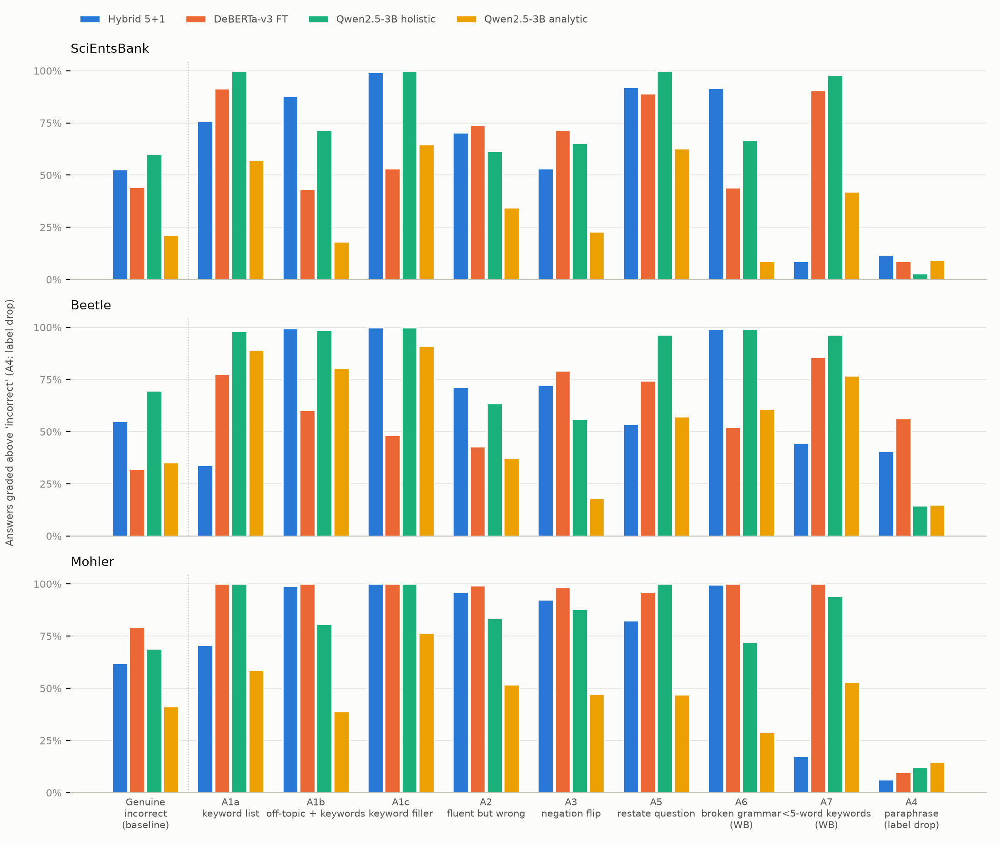
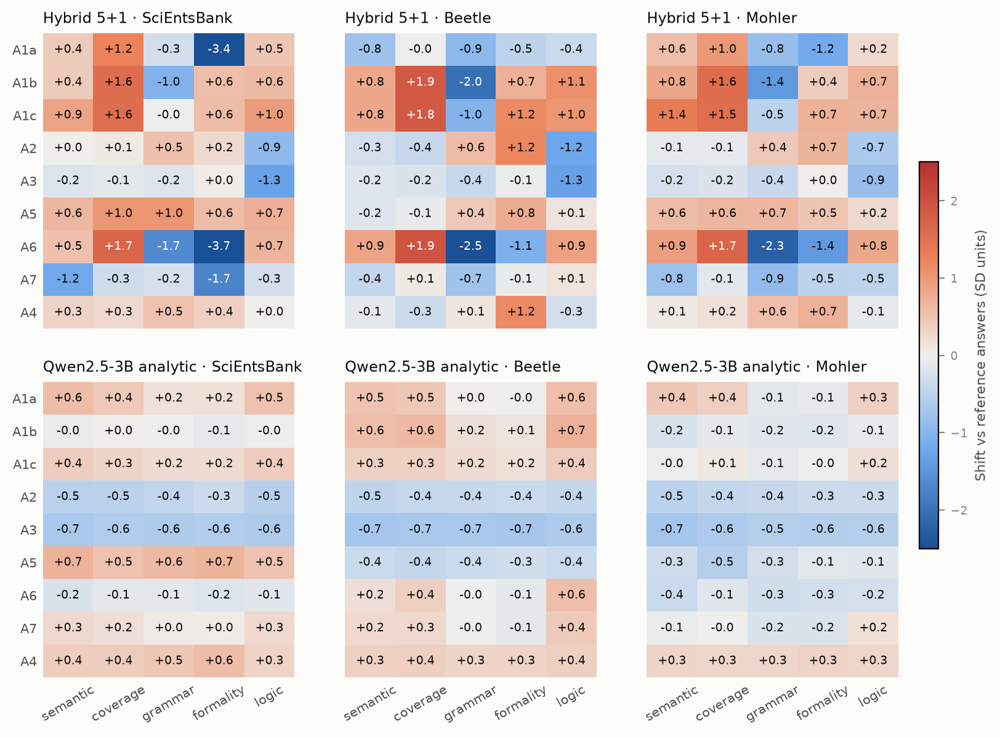
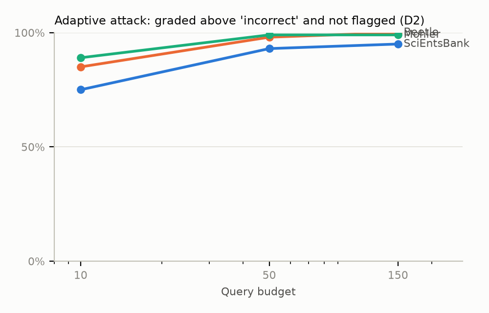

# Per-criterion robustness study — results

Generated by `python -m research.run_robustness report` at commit `70119cd`.

- **SciEntsBank** Hybrid weights (NNLS on train): semantic=0.19, coverage=0.35, formality=0.00, grammar=0.04, logic=0.42; label thresholds (dev) = [40.0, 66.0]
- **Beetle** Hybrid weights (NNLS on train): semantic=0.24, coverage=0.32, formality=0.01, grammar=0.07, logic=0.36; label thresholds (dev) = [36.0, 67.0]
- **Mohler** Hybrid weights (NNLS on train): semantic=0.60, coverage=0.20, formality=0.02, grammar=0.05, logic=0.13; label thresholds (dev) = [40.0, 62.0]

## 1. Clean agreement (QWK, 3-way; 95% CI = question-level bootstrap)

| System | Beetle UA | Beetle UQ | Mohler test | SciEntsBank UA | SciEntsBank UD | SciEntsBank UQ |
|---|---|---|---|---|---|---|
| Hybrid 5+1 | 0.469 [0.37,0.55] | 0.312 [0.16,0.43] | 0.320 [0.18,0.48] | 0.348 [0.27,0.43] | 0.342 [0.26,0.43] | 0.363 [0.27,0.48] |
| DeBERTa-v3 FT | 0.651±0.033 | 0.504±0.024 | 0.429±0.032 | 0.563±0.105 | 0.392±0.088 | 0.393±0.079 |
| Qwen2.5-3B holistic | 0.388 [0.27,0.49] | 0.333 [0.20,0.45] | 0.267 [0.18,0.35] | 0.476 [0.41,0.54] | – | 0.416 [0.29,0.50] |
| Qwen2.5-3B analytic | 0.332 [0.25,0.41] | 0.310 [0.15,0.46] | 0.167 [0.09,0.27] | 0.342 [0.27,0.41] | – | 0.356 [0.26,0.41] |
| Semantic only | 0.405 [0.31,0.49] | 0.283 [0.14,0.41] | 0.263 [0.13,0.41] | 0.349 [0.27,0.43] | 0.357 [0.27,0.44] | 0.323 [0.21,0.45] |
| Coverage only | 0.480 [0.40,0.55] | 0.272 [0.09,0.42] | 0.270 [0.14,0.42] | 0.271 [0.19,0.34] | 0.254 [0.18,0.33] | 0.317 [0.17,0.43] |
| Logic (NLI) only | 0.346 [0.26,0.43] | 0.262 [0.14,0.39] | 0.168 [0.04,0.32] | 0.348 [0.26,0.43] | 0.287 [0.20,0.37] | 0.357 [0.23,0.46] |
| Hybrid (paper weights) | 0.458 [0.38,0.53] | 0.276 [0.12,0.42] | 0.233 [0.09,0.39] | 0.375 [0.30,0.45] | 0.362 [0.27,0.45] | 0.389 [0.30,0.50] |
| Hybrid (uniform weights) | 0.398 [0.31,0.48] | 0.243 [0.10,0.40] | 0.202 [0.07,0.36] | 0.419 [0.34,0.50] | 0.360 [0.28,0.44] | 0.383 [0.31,0.48] |

## 2. Attack success (% graded above the expected label; A4 = % whose label drops)

### SciEntsBank

| Attack | n | Hybrid 5+1 | DeBERTa-v3 FT | Qwen2.5-3B holistic | Qwen2.5-3B analytic | Semantic only | Coverage only | Logic (NLI) only |
|---|---|---|---|---|---|---|---|---|
| Genuine incorrect (baseline) | 451 | 53 | 44±13 | 60 | 21 | 52 | 67 | 54 |
| A1a keyword list | 150 | 76 | 92±2 | 100 | 57 | 76 | 85 | 73 |
| A1b off-topic + keywords | 600 | 88 | 43±21 | 72 | 18 | 73 | 100 | 73 |
| A1c keyword filler | 150 | 99 | 53±13 | 100 | 65 | 97 | 100 | 93 |
| A2 fluent but wrong | 367 | 70 | 74±15 | 61 | 34 | 83 | 95 | 54 |
| A3 negation flip | 423 | 53 | 72±15 | 65 | 23 | 81 | 91 | 30 |
| A5 restate question | 150 | 92 | 89±7 | 100 | 63 | 85 | 98 | 87 |
| A6 broken grammar (WB) | 600 | 92 | 44±10 | 67 | 9 | 82 | 100 | 72 |
| A7 <5-word keywords (WB) | 150 | 9 | 91±2 | 98 | 42 | 0 | 97 | 100 |
| A4 paraphrase (label drop) | 382 | 12 | 9±2 | 3 | 9 | 7 | 10 | 4 |

### Beetle

| Attack | n | Hybrid 5+1 | DeBERTa-v3 FT | Qwen2.5-3B holistic | Qwen2.5-3B analytic | Semantic only | Coverage only | Logic (NLI) only |
|---|---|---|---|---|---|---|---|---|
| Genuine incorrect (baseline) | 454 | 55 | 32±4 | 70 | 35 | 72 | 58 | 43 |
| A1a keyword list | 56 | 34 | 77±10 | 98 | 89 | 34 | 34 | 29 |
| A1b off-topic + keywords | 600 | 100 | 60±8 | 98 | 80 | 100 | 100 | 79 |
| A1c keyword filler | 56 | 100 | 48±11 | 100 | 91 | 100 | 100 | 88 |
| A2 fluent but wrong | 326 | 71 | 43±11 | 63 | 37 | 99 | 87 | 28 |
| A3 negation flip | 399 | 72 | 79±9 | 56 | 18 | 94 | 84 | 19 |
| A5 restate question | 56 | 54 | 74±1 | 96 | 57 | 70 | 52 | 50 |
| A6 broken grammar (WB) | 598 | 99 | 52±12 | 99 | 61 | 99 | 99 | 72 |
| A7 <5-word keywords (WB) | 56 | 45 | 86±5 | 96 | 77 | 62 | 62 | 14 |
| A4 paraphrase (label drop) | 359 | 41 | 56±7 | 14 | 15 | 33 | 42 | 32 |

### Mohler

| Attack | n | Hybrid 5+1 | DeBERTa-v3 FT | Qwen2.5-3B holistic | Qwen2.5-3B analytic | Semantic only | Coverage only | Logic (NLI) only |
|---|---|---|---|---|---|---|---|---|
| Genuine incorrect (baseline) | 29 | 62 | 79±9 | 69 | 41 | 69 | 100 | 62 |
| A1a keyword list | 17 | 71 | 100 | 100 | 59 | 71 | 100 | 65 |
| A1b off-topic + keywords | 300 | 99 | 100 | 81 | 39 | 95 | 100 | 81 |
| A1c keyword filler | 17 | 100 | 100 | 100 | 76 | 100 | 100 | 100 |
| A2 fluent but wrong | 178 | 96 | 99±1 | 84 | 52 | 97 | 100 | 62 |
| A3 negation flip | 157 | 92 | 98±2 | 88 | 47 | 95 | 100 | 46 |
| A5 restate question | 17 | 82 | 96±3 | 100 | 47 | 82 | 100 | 71 |
| A6 broken grammar (WB) | 295 | 100 | 100 | 72 | 29 | 98 | 100 | 80 |
| A7 <5-word keywords (WB) | 17 | 18 | 100 | 94 | 53 | 18 | 100 | 53 |
| A4 paraphrase (label drop) | 191 | 6 | 10±3 | 12 | 15 | 5 | 5 | 5 |

## 3. Which criterion is fooled (mean shift in SD units vs. reference answers)

Reference = the source answer for A2/A3/A4, genuine incorrect answers otherwise.

## 4. Detection (threshold set for 5% flags on genuine dev answers)

| dataset | detector | auroc | tpr@5%fpr(oracle) | tpr(dev thr) | fpr_clean(dev thr) | fpr_clean_correct | fpr_A4_paraphrase | asr_undefended | asr_defended |
|---|---|---|---|---|---|---|---|---|---|
| scientsbank | D0_cdi_rule | 0.539 | 0.092 | 0.092 | 0.013 | 0.007 | 0.021 | 0.762 | 0.67 |
| scientsbank | D1_cdi_score | 0.718 | 0.2 | 0.22 | 0.066 | 0.039 | 0.037 | 0.762 | 0.585 |
| scientsbank | D2_disagreement_lr | 0.816 | 0.474 | 0.424 | 0.047 | 0.034 | 0.016 | 0.762 | 0.378 |
| scientsbank | D3_boosting | 0.899 | 0.643 | 0.672 | 0.071 | 0.079 | 0.042 | 0.762 | 0.203 |
| beetle | D0_cdi_rule | 0.552 | 0.111 | 0.111 | 0.01 | 0.008 | 0.0 | 0.857 | 0.746 |
| beetle | D1_cdi_score | 0.705 | 0.243 | 0.168 | 0.025 | 0.019 | 0.028 | 0.857 | 0.689 |
| beetle | D2_disagreement_lr | 0.869 | 0.608 | 0.436 | 0.021 | 0.012 | 0.019 | 0.857 | 0.425 |
| beetle | D3_boosting | 0.912 | 0.707 | 0.643 | 0.024 | 0.015 | 0.058 | 0.857 | 0.246 |
| mohler | D0_cdi_rule | 0.535 | 0.072 | 0.072 | 0.004 | 0.006 | 0.0 | 0.955 | 0.883 |
| mohler | D1_cdi_score | 0.591 | 0.218 | 0.091 | 0.006 | 0.009 | 0.0 | 0.955 | 0.864 |
| mohler | D2_disagreement_lr | 0.809 | 0.476 | 0.432 | 0.025 | 0.016 | 0.021 | 0.955 | 0.526 |
| mohler | D3_boosting | 0.836 | 0.498 | 0.48 | 0.038 | 0.028 | 0.026 | 0.955 | 0.483 |

### Leave-one-attack-family-out

| dataset | held_out_family | detector | n | flag_rate_held_out | flag_rate_in_dist | fpr_clean |
|---|---|---|---|---|---|---|
| scientsbank | fluent_wrong | D2_disagreement_lr | 367 | 0.049 | 0.511 | 0.052 |
| scientsbank | fluent_wrong | D3_boosting | 367 | 0.172 | 0.745 | 0.062 |
| scientsbank | negation | D2_disagreement_lr | 423 | 0.09 | 0.539 | 0.049 |
| scientsbank | negation | D3_boosting | 423 | 0.069 | 0.774 | 0.057 |
| scientsbank | restate | D2_disagreement_lr | 150 | 0.053 | 0.457 | 0.05 |
| scientsbank | restate | D3_boosting | 150 | 0.12 | 0.669 | 0.077 |
| scientsbank | stuffing | D2_disagreement_lr | 900 | 0.453 | 0.354 | 0.048 |
| scientsbank | stuffing | D3_boosting | 900 | 0.206 | 0.596 | 0.057 |
| scientsbank | whitebox | D2_disagreement_lr | 750 | 0.595 | 0.296 | 0.039 |
| scientsbank | whitebox | D3_boosting | 750 | 0.071 | 0.577 | 0.055 |
| beetle | fluent_wrong | D2_disagreement_lr | 326 | 0.031 | 0.538 | 0.02 |
| beetle | fluent_wrong | D3_boosting | 326 | 0.058 | 0.701 | 0.021 |
| beetle | negation | D2_disagreement_lr | 399 | 0.085 | 0.593 | 0.019 |
| beetle | negation | D3_boosting | 399 | 0.065 | 0.751 | 0.029 |
| beetle | restate | D2_disagreement_lr | 56 | 0.0 | 0.477 | 0.021 |
| beetle | restate | D3_boosting | 56 | 0.018 | 0.642 | 0.025 |
| beetle | stuffing | D2_disagreement_lr | 712 | 0.305 | 0.329 | 0.021 |
| beetle | stuffing | D3_boosting | 712 | 0.434 | 0.581 | 0.025 |
| beetle | whitebox | D2_disagreement_lr | 654 | 0.625 | 0.263 | 0.021 |
| beetle | whitebox | D3_boosting | 654 | 0.497 | 0.587 | 0.03 |
| mohler | fluent_wrong | D2_disagreement_lr | 178 | 0.011 | 0.495 | 0.017 |
| mohler | fluent_wrong | D3_boosting | 178 | 0.045 | 0.554 | 0.034 |
| mohler | negation | D2_disagreement_lr | 157 | 0.127 | 0.478 | 0.028 |
| mohler | negation | D3_boosting | 157 | 0.083 | 0.562 | 0.047 |
| mohler | restate | D2_disagreement_lr | 17 | 0.059 | 0.442 | 0.023 |
| mohler | restate | D3_boosting | 17 | 0.059 | 0.499 | 0.038 |
| mohler | stuffing | D2_disagreement_lr | 334 | 0.434 | 0.361 | 0.021 |
| mohler | stuffing | D3_boosting | 334 | 0.159 | 0.468 | 0.03 |
| mohler | whitebox | D2_disagreement_lr | 312 | 0.603 | 0.236 | 0.013 |
| mohler | whitebox | D3_boosting | 312 | 0.635 | 0.318 | 0.028 |

### D2 logistic-regression coefficients (standardised)

| feature | scientsbank | beetle | mohler |
|---|---|---|---|
| cdi | 0.36 | 0.35 | 0.08 |
| gap_sem_log | -0.23 | -0.06 | -0.53 |
| gap_cov_sem | 0.88 | 0.68 | 0.73 |
| gap_gram_log | -0.5 | -1.36 | -0.74 |
| p_contra | 0.48 | 0.81 | 1.06 |
| p_entail | -0.15 | -0.71 | -0.29 |
| p_neutral | -0.21 | -0.52 | -0.18 |

## 5. Adaptive attacks

| dataset | budget | success_vs_D2 | evades_D3 | graded_correct |
|---|---|---|---|---|
| beetle | 10 | 0.85 | 0.79 | 0.26 |
| beetle | 50 | 0.98 | 0.4 | 0.85 |
| beetle | 150 | 1.0 | 0.37 | 0.96 |
| mohler | 10 | 0.89 | 0.81 | 0.2 |
| mohler | 50 | 0.99 | 0.72 | 0.92 |
| mohler | 150 | 0.99 | 0.57 | 0.99 |
| scientsbank | 10 | 0.75 | 0.72 | 0.07 |
| scientsbank | 50 | 0.93 | 0.48 | 0.84 |
| scientsbank | 150 | 0.95 | 0.39 | 0.89 |

### LLM-written coherent stuffing

| dataset | graded_above_incorrect | flag_D2 | flag_D3 | success_vs_D2 |
|---|---|---|---|---|
| beetle | 1.0 | 0.02 | 0.04 | 0.98 |
| mohler | 1.0 | 0.0 | 0.0 | 1.0 |
| scientsbank | 0.96 | 0.09 | 0.59 | 0.87 |

## 6. Label validation

Automatic checks (rows failing are excluded):

| attack | mean | count |
|---|---|---|
| A1a | 1.0 | 469 |
| A1b | 1.0 | 2850 |
| A1c | 1.0 | 469 |
| A2 | 0.893 | 1651 |
| A3 | 0.995 | 2087 |
| A4 | 0.953 | 1651 |
| A5 | 1.0 | 469 |
| A6 | 0.996 | 2850 |
| A7 | 1.0 | 469 |

**Human validation pending**: fill `validation/annotator_1.csv` and `annotator_2.csv`, then run `python -m research.run_robustness validate agree`.
